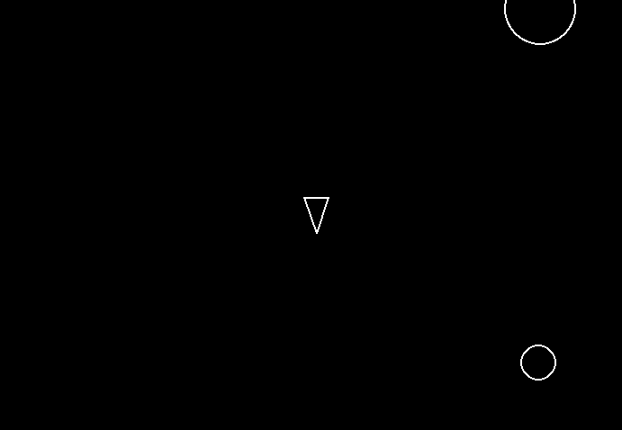

# Asteroids (Python + Pygame)

A clone of the classic arcade game **Asteroids**, built with Python and Pygame. Pilot a ship, shoot asteroids that split into smaller pieces, and survive as long as you can. One hit and it's game over.

> Built as part of the [Boot.dev](https://www.boot.dev) "Build Asteroids using Python and Pygame" project.




## Features

- Ship with rotation and forward/backward movement
- Shooting with a cooldown between shots
- Three asteroid sizes that split when shot: large → 2 medium → 2 small → destroyed
- Asteroids spawn continuously from random edges of the screen, with random speed and direction
- Circle-based collision detection
- Game over when an asteroid hits the ship (no lives)
- JSON event and state logging for debugging

## Controls

| Key | Action |
| --- | --- |
| `W` | Move forward |
| `S` | Move backward |
| `A` | Rotate left |
| `D` | Rotate right |
| `Space` | Shoot |

## Getting started

### Prerequisites

- [uv](https://docs.astral.sh/uv/getting-started/installation/)
- Python (the version is pinned in `.python-version` and `pyproject.toml`)

### Run

```bash
git clone https://github.com/joseequiroz26-cmd/Asteroids-Game-Pygame-Clone.git
cd Asteroids-Game-Pygame-Clone
uv run main.py
```

`uv` creates the virtual environment and installs the dependencies (Pygame) automatically on the first run.

## How it works

Every game object inherits from a shared base class, `Circleshape`, which extends `pygame.sprite.Sprite` and provides position, velocity, radius, and a `collides_with()` method based on the distance between two circles.

| File | Responsibility |
| --- | --- |
| `main.py` | Game loop, sprite groups, collision handling, 60 FPS cap |
| `circleshape.py` | Base class for all game objects |
| `player.py` | Ship: input handling, movement, rotation, shooting cooldown |
| `shot.py` | Projectiles fired by the ship |
| `asteroid.py` | Asteroid behavior, including `split()` into two smaller asteroids |
| `asteroidfield.py` | Spawns asteroids at random screen edges at a fixed rate |
| `constants.py` | Screen size, speeds, radii, cooldowns, and spawn rate |
| `logger.py` | Writes game events and periodic state snapshots as JSON lines |

### Asteroid splitting

Asteroid sizes are multiples of a minimum radius (20, 40, 60). When an asteroid is shot, it is removed and, if it is bigger than the minimum size, replaced by two smaller asteroids that fly off at a random angle between 20° and 50° from the original direction, slightly faster (x1.2).

### Logging

`logger.py` records gameplay events (`asteroid_shot`, `asteroid_split`, `player_hit`) to `game_events.jsonl` and takes roughly one state snapshot per second to `game_state.jsonl` during the first seconds of each run. These files are generated at runtime and are not part of the source code.

## Project structure

```
.
├── main.py
├── player.py
├── shot.py
├── asteroid.py
├── asteroidfield.py
├── circleshape.py
├── constants.py
├── logger.py
├── pyproject.toml
├── uv.lock
└── LICENSE
```

## What I learned

- Structuring a game with object-oriented design: a base class and subclasses for each entity.
- Using Pygame sprite groups to separate what gets updated, drawn, and checked for collisions.
- Frame-rate independent movement using delta time.
- Vector math for rotation, movement, and splitting trajectories.

## License

MIT. See [LICENSE](LICENSE).
